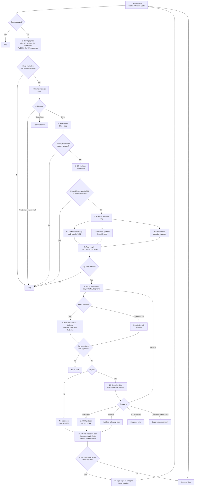

# PaidHR outbound GTM system

Work in progress. Built on `context/icp/icp.md`, `personas.md` and `signal-matrix.md`. Tools: Claude Code, Clay, HubSpot, n8n, PlusVibe, GitHub (treg as a data source inside Claude Code and Clay HTTP).

**Miro board:** pending. The Miro MCP failed to connect this session, so the board "PaidHR GTM System" is not drawn yet.

## Flow

### 1. Context OS
- **What:** ICP, personas, signal matrix, messaging and `facts.md` live in this repo. Every workflow and copy run reads them first.
- **Tool:** GitHub (source of truth), Claude Code (reads and edits).
- **Decisions:**
  - Is every claim in `facts.md` approved? Yes: copy may use it. No: it renders as `{{placeholder}}`.
  - Is the workflow spec STRUCTURE-APPROVED? Yes: go to step 2. No: stop.

### 2. Buying signals
- **What:** Run the 4 build-first signals (signal-matrix.md): W1 funding round, W2 headcount threshold, W3 HR or payroll role posted, W4 expansion outside Nigeria.
- **Tool:** n8n schedules each signal (W1 daily news scan, W2 monthly headcount snapshot, W3/W4 weekly job pulls); Clay receives rows.
- **Decisions:**
  - Signal fired in the window (90 days funding, 30 days jobs, month-on-month headcount)? Yes: step 3. No: drop.
  - Already seen this company for this signal in 90 days? Yes: drop (dedupe). No: continue.

### 3. Find companies
- **What:** Turn each signal row into a company record with domain and LinkedIn URL.
- **Tool:** Clay (Find Organization / company lookup).
- **Decisions:**
  - Domain resolved? Yes: step 4. No: send to a "manual review" Clay view; skip.
  - Already in HubSpot as customer, open deal or closed-lost under 90 days? Customer or open deal: drop. Closed-lost: route to reactivation list. New: continue.

### 4. Enrichment
- **What:** Add HQ country, headcount, industry, locations, funding stage.
- **Tool:** Clay enrichment; treg LinkedIn company profile ($0.0015 per company) via Clay HTTP.
- **Decisions:**
  - Required fields present (country, headcount, industry)? Yes: step 5. No: one more provider in the waterfall; still missing: drop.

### 5. ICP fit check
- **What:** Score against icp.md tiers.
- **Tool:** Clay formula column (rules from icp.md).
- **Decisions:**
  - HQ Nigeria? No: Tier 3 only if it has Nigerian staff, else drop.
  - Headcount under 20? Yes: drop (not a fit, icp.md). 20 to 100: Tier 1 candidate. 100+: Tier 2 candidate.
  - Needs EOR (no entity where staff sit)? Yes: drop (not a fit). No: continue.
  - Fit score passes? Yes: step 6. No: drop, log reason.

### 6. Routing by segment
- **What:** Assign S1, S2 or S3 (signal-matrix.md Matrix 1), which sets the angle and persona order.
- **Tool:** Clay conditional columns.
- **Decisions:**
  - Funded tech startup, 20 to 100: S1, lead persona founder/CEO, then HR lead.
  - Logistics, retail or manufacturing, 100+: S2, lead persona HR lead (economic buyer is an open question).
  - Staff or roles outside Nigeria: S3, cross-border angle.
  - Matches more than one: priority S1 > S3 > S2 (S1 is the only proven segment).

### 7. Find people
- **What:** Find up to 2 contacts per company: champion and economic buyer.
- **Tool:** Clay Find People (title filters from personas.md).
- **Decisions:**
  - Champion found (HR Manager, HR Operations, People Ops, Payroll)? Yes: add. No: skip to buyer.
  - Economic buyer found (CEO, Co-founder; S2: COO or Finance, INFERRED)? Yes: add. No: if no contact at all, drop company.
  - Founder and HR lead are the same person? Yes: one contact, buyer angle.

### 8. Find and verify emails
- **What:** Find work email, verify before any send (treg rule: a found email is a best match, not confirmed).
- **Tool:** Clay email waterfall plus verification; treg `treg.people.email.verify` as fallback.
- **Decisions:**
  - Verified valid? Yes: email + LinkedIn sequence. Catch-all or risky: LinkedIn only. Invalid or not found: LinkedIn only.
  - Domain on a former employer (domain mismatch)? Yes: discard email.

### 9. Sequence (email and LinkedIn)
- **What:** Signal-led copy from `/campaign-copy`, using only `facts.md`. 31 Jan 2027 tax return as the timing hook. No em dashes, no banned words.
- **Tool:** PlusVibe (email and LinkedIn steps); Claude Code writes copy; Clay pushes leads to PlusVibe.
- **Decisions:**
  - Lead passes `/campaign-qa`? Yes: launch. No: fix the row or copy.
  - Approved to send (rule 4: ask before sending)? Yes: launch. No: hold.
  - Reply received? Yes: step 10, stop the sequence. No reply after last step: mark "no response", recycle after 90 days.

### 10. Reply handling
- **What:** Classify every reply.
- **Tool:** PlusVibe reply detection; n8n classifies (Claude) and routes.
- **Decisions:**
  - Interested: create deal in HubSpot, alert the owner, book a demo.
  - Not now: HubSpot task to follow up on the date given, or 90 days.
  - Wrong person / referral: add the referred person, restart at step 8.
  - Not interested: suppress for 180 days.
  - Unsubscribe or bounce: suppress permanently.

### 11. CRM
- **What:** Contacts, company, signal, segment, sequence, reply class and deal stage logged.
- **Tool:** HubSpot (system of record); n8n syncs from PlusVibe and Clay.
- **Decisions:**
  - Contact exists? Yes: update and keep owner. No: create.
  - Deal created? Yes: tag source workflow (W1 to W4) for attribution.

### 12. Weekly feedback loop
- **What:** Every week, pull results per workflow and feed them back into the Context OS.
- **Tool:** n8n exports HubSpot and PlusVibe stats; Claude Code updates the files; GitHub commits.
- **Decisions:**
  - Workflow reply rate below target after 2 weeks? Yes: change the angle or kill the signal (log in `knowledge-base/learnings/`). No: keep.
  - New objection or pain heard? Yes: update personas.md and messaging.md.
  - New customer proof approved? Yes: add to facts.md.
  - Update Matrix 3 tracker in signal-matrix.md (sent, replies, meetings).
  - Write the week's learnings in `work-log/` and next week's `weekly-priorities/`.

## Four pillars check

| Pillar | How the system meets it | Gap |
|---|---|---|
| Clean data | Dedupe at steps 2 and 3, required-field check at 4, verified emails only at 8, HubSpot as one record | Nigerian data coverage in Clay and job tools is unknown (signal-matrix.md) |
| Always-on signals | n8n schedules every signal; no one-off lists | W1 volume is low (51 deals in H1 2026); relies on W2 for volume |
| Composable workflows | Steps 3 to 11 are shared; only the signal (step 2) and angle (step 6) change per workflow | Copy per segment still needs its own spec |
| Tight feedback loops | Weekly loop writes results back into icp, personas, messaging, facts and the tracker, versioned in GitHub | Targets for reply rate not set yet |

## Open questions

- Reply-rate and meeting targets per workflow.
- S2 economic buyer.
- Sender identity (facts.md).
- HubSpot, PlusVibe and n8n accounts: assumed, not confirmed set up.

## Flowchart

